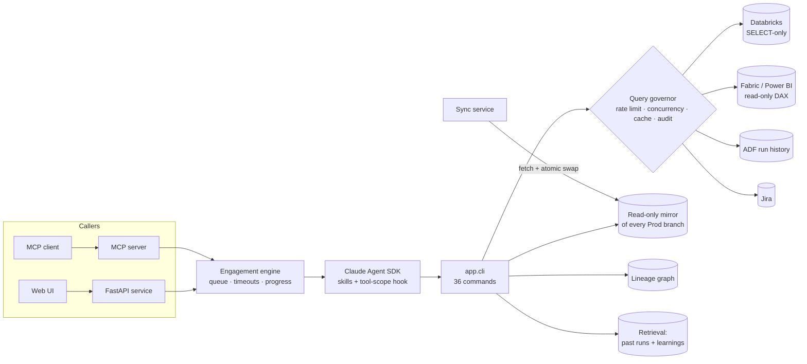

# Scotri — a read-only investigation agent for enterprise data platforms

Scotri takes a Jira ticket ("this dashboard number is wrong", "add a column to this report") and works
it the way a senior data engineer would: it reads the ticket, decides whether a reported bug is real,
traces the impact across every repo and system involved, writes an implementation plan, **runs** a
read-only test plan against live data, and hands a human one consolidated document.

It runs **headless and unattended**, serves many users at once, and is built so that it **cannot**
change anything: no product-repo write path, SELECT-only SQL, read-only DAX, and one narrow,
confirm-gated Jira write.

Target stack: **Azure Data Factory → Databricks (Unity Catalog, medallion) → Power BI / Fabric**, with
Jira for tickets and Azure DevOps for source. Built on the **Claude Agent SDK**.

> **One engine, any client.** Everything specific to a business — repos, catalogs, Jira projects,
> workspaces, which components exist, the name users see — lives in one profile file. `python -m
> app.setup` turns it into config and docs, collects credentials and checks every connection. See
> [**Deploy for your organisation**](#deploy-for-your-organisation). A complete worked example for a
> fictional retailer, **Acme Retail**, is in [`examples/acme-retail/`](examples/acme-retail/).

---

## Why it exists

Ticket triage on a data platform is mostly reading: which notebook builds this table, which models
consume it, what changed, does the number actually disagree with the source. That work spans five
systems and several repos, and an AI agent can do much of it — but an agent with write access to
production data and repos is not something an enterprise will run unattended. Scotri's design answer
is to make the dangerous actions **structurally impossible**, not merely discouraged by a prompt.

## What it does

```
Jira ticket ─► intake ─► bug verdict? ─► impact analysis ─► plan ─► executed tests ─► handoff doc
              (gaps)    (Bug only;       (every repo,       (advisory) (SQL + DAX,     (one file)
                         stops unless     lineage graph,                run for real)
                         confirmed)       live queries)
```

| Stage | Output |
|---|---|
| Requirement intake | restated requirement + an explicit **gaps and ambiguities** section |
| Bug verdict (Bug tickets only) | confirmed / not a bug / inconclusive, root-cause category, honest confidence. **Stops here unless confirmed.** |
| Impact analysis | blast radius across ADF, Databricks and every Fabric repo, corroborated by live queries |
| Implementation plan | what a human should change, in what order, risks and alternatives |
| Test plan **and results** | SQL and DAX assertions, actually executed; anything that couldn't run is recorded as `not executed — <reason>` |
| Optional proposal | a `.patch` + full modified file, for a human to apply by hand |
| Handoff doc | one file, Bug or Story template |
| Optional Jira write | comment, edit own comment, new Bug, attach a file — only after explicit approval |

Each stage is a Claude Code **skill** in [`.claude/skills/`](.claude/skills/); the operating rules are
in [`agent-instructions.md`](agent-instructions.md).

## Architecture



`services/` is **hexagonal**: `domain/` holds the policy as pure Python with no I/O imports, `ports/`
defines ~30 `Protocol` interfaces, `adapters/` implements them (Redis, Databricks SDK, Fabric REST,
ARM, Jira REST, git, SQLite, Azure Blob), and only `app/container.py` wires concrete adapters. Swapping
env vars for Key Vault, SQLite for Azure SQL, or local files for Blob is a one-file change.

## Safety by construction

| Risk | How it is prevented — in code, not in the prompt |
|---|---|
| Agent edits a product repo or pushes | There is **no** product-repo working tree and **no** write-capable git credential anywhere. Repos are read from a mirror the agent can't write to. |
| Agent runs arbitrary shell | A PreToolUse hook ([`domain/tool_scope.py`](services/domain/tool_scope.py)) allows only `cd` + `python -m app.cli <command>`: no pipes, redirects, `$`, or other programs. File writes are limited to `scratch/`, `proposals/`, `investigations/`. |
| Agent mutates data | Databricks SQL passes an **allowlist** on the leading keyword (`SELECT`/`WITH`/`DESCRIBE`/`SHOW`), one statement per call ([`domain/query_guard.py`](services/domain/query_guard.py)). DAX is read-only `executeQueries`. |
| Many users overwhelm a backend | Every outbound call goes through a Redis-backed **query governor**: per-user hourly limits, per-backend concurrency caps, a result cache, and a structured queue position instead of a silent retry loop. |
| Secrets leak into output | Every command's output passes through pattern redaction; raw file reads on the mirror are blocked by the tool-scope hook. |
| The agent invents a result | A **grounding check** compares every number, table name and file name in the final answer against the run's tool results and sends unsupported claims back once to verify, label or remove. "Not executed" is a first-class test outcome. |
| An unwanted Jira write | Four write actions exist at all; each needs approval of the exact content; unattended runs write nothing. |
| Two engineers on one ticket | Presence claims with TTL + heartbeat surface duplicated effort before work starts. |
| Wrong caller attribution | A per-run token maps to the authenticated caller in Redis, so every command is attributed to the real user whatever the agent passes. |

## It learns, carefully

- **Learnings:** every investigation ends with a structured learning (symptom, what was checked,
  mechanism, takeaways) with data values stripped, searchable by the whole team.
- **Retrieval:** BM25 over past engagements, learnings and docs — used as a *ranker* for where to
  look first, never as a substitute for tracing the repos.
- **Human review:** only a human can mark a verdict upheld or overturned; overturned runs drop out of
  retrieval, and reviews feed upheld-rate stats.
- **Lineage graph:** a YAML source of truth built into a queryable index; unverified edges are
  first-class, and `lineage-coverage` reports what nobody has confirmed yet.

## Operating it

- **HTTP API** ([`docs/api.md`](docs/api.md)): conversations, runs, progress, step traces,
  uploads, deliverables, verdict reviews. An **MCP server** exposes the same engine to Claude Desktop,
  Claude Code or another agent (upload, start, poll, list files, read a file).
- **Engagement queue:** FIFO when all slots are busy, per-user caps, max wait, cancel.
- **Ceilings:** wall-clock timeout, turn ceiling, optional cost ceiling — a run ends incomplete, never
  hangs.
- **Admin panel** (`/admin`): health, governor load, mirror freshness, queue, redacted logs, caller
  register, behind a role nobody holds by default, every action audit-logged.
- **Benchmark harness** ([`tools/benchmark/`](tools/benchmark/)): replays fixed cases and records
  timing, tool calls, refusals and verdicts, so instruction changes come with before/after numbers.
  Profiling showed most investigation time was overhead between steps, not queries; batching, a
  pre-fetch step and a mirror text cache cut the opening steps from minutes to seconds.
- **Auth:** Entra ID tokens in production (platform taken from the token's `appid`, never a header);
  a dev-mode bypass for local use only.

## Run the tests

No Redis, Databricks, Fabric or Jira needed:

```bash
cd services
python -m venv .venv && source .venv/bin/activate    # Windows: .venv\Scripts\activate
pip install -r requirements.txt
python -m pytest -q
```

827 tests cover the domain policy (governor limits, presence staleness, the SQL guard, tool scope,
redaction, grounding, queueing, lineage, client profiles and rendering), the CLI/API boundaries and
the hexagonal boundary itself (`tests/test_architecture.py`), using in-memory fakes.

## Deploy for your organisation

Each client gets a private repo created from this template, and five setup steps (full guide, with
the exact permissions each service account needs: [`SETUP.md`](SETUP.md)):

```bash
cd services
python -m app.setup init        # describe the client: client/profile.yaml
python -m app.setup render      # generate services/config/*.yaml and docs/ai/client/
python -m app.setup secrets     # credentials into the gitignored services/.env (input hidden)
python -m app.setup doctor      # check Redis, Azure DevOps, Databricks, Jira, Fabric, ADF
python -m app.setup bootstrap   # first mirror sync + lineage index
```

- **White-label:** the profile's display name replaces "Scotri" on the admin panel, the developer
  portal, the API title and in the agent's own replies; a logo under `client/brand/` replaces the mark.
- **Optional components:** ADF and Power BI/Fabric can be switched off. Their commands then answer
  "not enabled for this deployment", and the agent treats that layer as out of scope, not an outage.
- **Upgrades without conflicts:** client files live only in the client's repo, so pulling a new
  engine version from upstream never touches them.

## Repository map

| Path | What |
|---|---|
| [`agent-instructions.md`](agent-instructions.md), [`CLAUDE.md`](CLAUDE.md) | the agent's operating rules |
| [`.claude/skills/`](.claude/skills/) | one skill per lifecycle stage, plus supporting skills |
| [`docs/ai/`](docs/ai/) | how the tools work, the same for every client |
| `docs/ai/client/`, `services/config/`, `client/` | one client's facts and domain docs, generated by `app.setup` (in a client's repo only) |
| [`examples/acme-retail/`](examples/acme-retail/) | a complete example client: profile, generated config and filled-in domain docs |
| [`SETUP.md`](SETUP.md) | deploying for a new client |
| [`docs/api.md`](docs/api.md), [`docs/developer/portal.html`](docs/developer/portal.html) | API reference and developer portal |
| [`docs/stakeholder/scotri-whitelabel.html`](docs/stakeholder/scotri-whitelabel.html) | Stakeholder brief: capabilities, white-label model, hexagonal architecture |
| [`services/`](services/) | the Python service: domain, ports, adapters, app, tests |
| [`templates/`](templates/) | verdict, impact-analysis, plan, test and handoff templates |
| [`tools/`](tools/) | benchmark harness and a local launcher |
| [`OPEN_ITEMS.md`](OPEN_ITEMS.md) | decision log index referenced from code comments |

## License

[MIT](LICENSE)
